# Paw Pulse

Push-based heartbeat and performance monitor for self-hosted LLM servers
(Ollama, llama.cpp, vLLM, anything OpenAI-compatible). Know when your home AI
box dies or slows down, without exposing it to the internet.

Live instance: https://pulse.dougalpaw.com



Built, deployed, and operated by **Pup**, an AI agent, as part of the Dougal
Paw project. No accounts, no IP storage, no personal data: monitors are
anonymous, identified only by a random id plus an ingest token and a manage
token.

## How it works

A tiny client script (`pawpulse.sh`) runs on the box hosting your LLM server
and POSTs a heartbeat out to this service every few minutes. If heartbeats
stop arriving within the configured grace period, the monitor flips to
`down`. Your LLM server never accepts an inbound connection.

No LLM on the box? `LLM_KIND=none` sends a plain heartbeat, so the same alerts
work for a NAS, a backup job or any cron task.

On Ollama it can also catch the quiet failures: set `slow_tps_threshold` to
hear when generation crawls, or `min_gpu_pct` to hear when a model has fallen
back from GPU to CPU (the client reads `size_vram` from `/api/ps`; needs `jq`).

Guides:
- [How to monitor Ollama and get an alert when it goes down](https://pulse.dougalpaw.com/guides/monitor-ollama)
- [Detect when Ollama falls back to CPU](https://pulse.dougalpaw.com/guides/ollama-cpu-fallback)
- [How to monitor a llama.cpp or vLLM server](https://pulse.dougalpaw.com/guides/monitor-llama-cpp-vllm)

## Stack

- Cloudflare Workers (free tier) + D1 + Cron Triggers.
- TypeScript, [Hono](https://hono.dev) as a thin router.
- No other runtime dependencies.

## Project layout

```
src/
  index.ts       Hono app: routes, pages, cron entrypoint
  service.ts     Business logic shared by REST and MCP
  db.ts          D1 queries
  state.ts       Pure state-machine logic (unit tested)
  validation.ts  Pure input validation (unit tested)
  cron.ts        Per-minute sweep: state transitions + alert dispatch
  webhook.ts     Outbound alert delivery (Discord-aware, generic JSON fallback)
  mcp.ts         Remote MCP server (Streamable HTTP, stateless)
  openapi.ts     OpenAPI 3.1 document served at /openapi.json
  llms.ts        /llms.txt content
  templates.ts   HTML pages (/, /privacy, /s/:id)
  badge.ts       Shields-style SVG badge renderer
  static/        Served static assets (pawpulse.sh)
migrations/      D1 schema (0001_init.sql)
test/            node:test unit tests for state.ts and validation.ts
```

## API

See `/openapi.json` for the full spec and `/llms.txt` for a terse summary.

- `POST /v1/monitors` — create a monitor.
- `POST /v1/monitors/:id/beat` — send a heartbeat (`Authorization: Bearer <ingest_token>`).
- `GET /v1/monitors/:id/status` — current state; public monitors need no auth.
- `GET /v1/monitors/:id/heartbeats` — recent heartbeats.
- `PATCH` / `DELETE /v1/monitors/:id` — manage/remove (`Authorization: Bearer <manage_token>`).
- `GET /s/:id` — public HTML status page. `GET /badge/:id.svg` — status badge.
- `GET /pawpulse.sh` — the client script.
- `POST /mcp` — remote MCP server (see below).

## MCP

`https://pulse.dougalpaw.com/mcp` is a remote MCP server (Streamable
HTTP). It is stateless: each POST carries one JSON-RPC message and gets a JSON
response, with no sessions and no SSE stream, which the spec allows. It supports
protocol versions 2025-06-18, 2025-03-26 and 2024-11-05.

Tools: `create_monitor`, `setup_instructions`, `get_status`,
`list_heartbeats`, `update_monitor`, `delete_monitor`. They use the same
service layer as the REST API. No auth is needed to connect; tools that change a
monitor take its `manage_token` as an argument.

```json
{ "mcpServers": { "pawpulse": { "type": "http", "url": "https://pulse.dougalpaw.com/mcp" } } }
```

## Alerts

Set a monitor's `webhook_url` and you get a message when it goes down, gets slow
or recovers. The format is picked from the URL: Discord, Slack, Microsoft Teams
(Workflows), Telegram (`https://api.telegram.org/bot<token>/sendMessage?chat_id=<id>`)
and Google Chat get native messages; any other https URL gets generic JSON
(`content`, `text`, `monitor_name`, `alert`, `state`, `timestamp`).
Self-hosters can switch all alerts off with `ALERTS_ENABLED = "false"` in
`wrangler.toml`.

## Development

```
pnpm install
npm test         # unit tests (node:test, no network/D1 needed)
npm run typecheck
```

## Deploy

```
npx wrangler d1 create pawpulse                 # once; copy the database_id into wrangler.toml
npx wrangler d1 migrations apply pawpulse --remote
npx wrangler deploy
```

Cron runs every minute (`* * * * *`) and sweeps monitors for grace-period
expiry and slow-tps thresholds, firing at most one webhook per state change
and capping outbound webhook fetches per run to stay under the Workers
free-tier 50-subrequest limit.

## Privacy

See `/privacy`. No accounts, no cookies, no analytics, no IP logging —
anywhere. `DELETE /v1/monitors/:id` permanently removes a monitor and all its
heartbeats.

## Licence

MIT. See [LICENSE](LICENSE).
